# AML/KYC Lakehouse on Databricks

An end-to-end data pipeline that ingests synthetic KYC/AML data from Amazon S3 into a Databricks lakehouse (medallion architecture), governed by Unity Catalog.

**Status:** Bronze layer complete. Silver, Gold, governance, orchestration, CI/CD and monitoring are in progress (see [Roadmap](#roadmap)).

## Scenario

A bank needs to monitor customer transactions for money-laundering risk. Three feeds arrive as files in S3:

- **Transactions:** high-volume events (JSON lines)
- **Customers:** a change feed, with attribute changes over time (CSV)
- **Watchlist:** small, slow-changing sanctions reference data (CSV)


## Architecture


### Project Sections
1. Synthetic Data Generation
2. AWS Setup and Data Load to s3
3. Databricks Connection to AWS
4. The Medallion Layer (Bronze, Silver and Gold)
5. Data Governance
6. Dashboard and Visualization
7. Orchestration
8. Monitoring and Alerts

## Step 1: Synthetic Data Generation
The data used in this project is fully synthetic. Names, SSNs (9xx range, never issued) and accounts are fake. This is the  used to generate the synthetic data.
 
### Data model

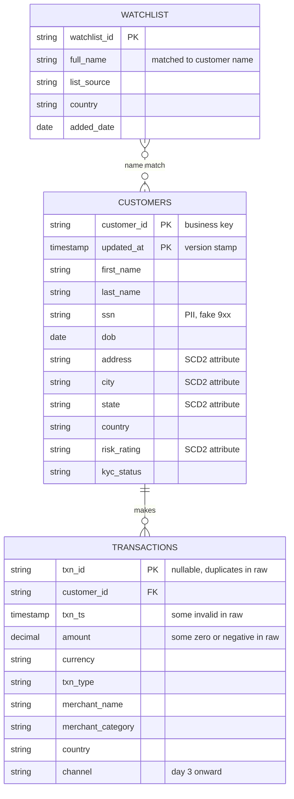

### Planted data issues (what each one tests)

| Issue | Purpose |
|---|---|
| Null and duplicate `txn_id` | Silver dedup and expectations |
| Zero or negative `amount` | Expectations and quarantine |
| Unparseable `txn_ts` (`not-a-date`, empty) | Type casting in Silver; Bronze must not reject bad values |
| New column called `channel` from day 3 | Auto Loader schema evolution |
| Customer address and risk rating changes | SCD Type 2 |
| Late-arriving file for day 2 (`--late`) | Auto Loader tracks files, not folders |
| Structuring (4-6 deposits of 9,000-9,900) and high-risk-country transfers | AML detection scenarios in Gold |
| Customer names matching the watchlist | Screening and false-positive handling |

## Step 2: AWS Setup and Data Load to s3
In this project we moved the generated data to S3 to mimic real life situation. We can have data coming from various sources but most times, they make their way to S3 raw and unfiltered. Using S3 provides the opportunity to learn all the necessary steps needed to connect S3 to Databricks. The S3 setup step can be skipped if AWS cost will be an issue.

### 1. S3 bucket
Create a bucket (this project uses `kyc-lakehouse-gracomot`) with default SSE-S3 encryption. Create a unique name for your S3 bucket. Upload the landing folders with the specifications (files) below;
Create a managed folder and checkpoint folders inside the bucket. `managed/` is used by Unity Catalog and stays empty of hand-written files.

```
kyc-lakehouse-<id>/
  landing/
    watchlist/
      watchlist.csv
    customers/
      dt=2026-10-25/customers.csv (day1)
      dt=2026-10-26/customers.csv (day2)
    transactions/
      dt=2026-10-25/transactions_001.json (day1)
      dt=2026-10-26/transactions_001.json (day2, leave out transactions_late_002)
  managed/        (Unity Catalog uses this, leave it empty)
  checkpoints/    (leave it empty for now)
```
As suggested above, we are loading day1 and day2 data for customers and transactions. We are leaveing out the late file in the transaction day2 folder as this will be used to explain how autoloader handles late arriving data. Watchlist is a single small file so it should be loaded.

### 2. IAM role for Unity Catalog

Role name: `kyc-lakehouse-uc-s3-access`. Setup is two passes, because the role must exist before it can trust itself and the external ID only exists after the storage credential is created.

**Step 1: create the role** 

In the AWS console, go to IAM, then Roles, then Create role. Choose Custom trust policy and paste the code below

```json
{
  "Version": "2012-10-17",
  "Statement": [{
    "Effect": "Allow",
    "Principal": { "AWS": ["arn:aws:iam::414351767826:role/unity-catalog-prod-UCMasterRole-14S5ZJVKOTYTL"] },
    "Action": "sts:AssumeRole",
    "Condition": { "StringEquals": { "sts:ExternalId": "0000" } }
  }]
}
```
That principal is a fixed Databricks-owned role, and the policy uses *0000* as a placeholder external ID. This will be changed after we create a credentials in databricks. Confirm the ARN against the current Databricks storage credential page before you save, because it’s a constant they could have changed since the writing of this documentation.

Click Next, skip attaching permissions for now, name the role, and create it.

**Step 2: create the S3 Policy** 

In the AWS console, go to IAM, then Policies, then Create policy, JSON tab. Replace the three placeholders <BUCKET>, <AWS-ACCOUNT-ID>, <ROLE-NAME>

```json
{
  "Version": "2012-10-17",
  "Statement": [
    {
      "Effect": "Allow",
      "Action": [
        "s3:GetObject",
        "s3:PutObject",
        "s3:DeleteObject",
        "s3:ListBucket",
        "s3:GetBucketLocation"
      ],
      "Resource": [
        "arn:aws:s3:::<BUCKET-NAME>/*",
        "arn:aws:s3:::<BUCKET-NAME>"
      ]
    },
    {
      "Effect": "Allow",
      "Action": ["sts:AssumeRole"],
      "Resource": ["arn:aws:iam::<AWS-ACCOUNT-ID>:role/<ROLE-NAME>"]
    }
  ]
}
```
**Step 3: Attach the S3 Policy **
Attach the S3 policY to the role. Open your role, then Permissions, then Add permissions, then Attach policies, and select the policy.

**Step 4: Copy the Role ARN **
Copy the role ARN. It’s at the top of the role page and looks like arn:aws:iam::<AWS-ACCOUNT-ID>:role/kyc-lakehouse-uc-role.

## Step 3: Databricks Connection to AWS
In this step, we connnect AWS S3 to databricks so we can access the data in our S3 bucket from databricks. 
Navigate to your databricks account;
1. **Catalog > External data > Credentials > Create credential**, select *Storage credential*, type AWS IAM Role. Enter a name and the role ARN. Databricks then shows the external ID. Copy the external ID.

2. **Finish the trust policy**
Back in AWS, open the role, go to the Trust relationships tab, and replace the <EXTERNAL_ID> that was prviously 0000 with the one provided by databricks.

3. Create an **external location** (manual setup) named `kyc_lakehouse_loc` on `s3://<bucket-nam>` using that credential.

4. Click **Test connection**. A pass confirms the role, trust policy and permissions are aligned.

## Step 4: The Medallion Layer (Bronze, Silver and Gold)

```sql
CREATE CATALOG IF NOT EXISTS dev_kyc
  MANAGED LOCATION 's3://kyc-lakehouse-gracomot/managed';

CREATE SCHEMA IF NOT EXISTS dev_kyc.bronze;
CREATE SCHEMA IF NOT EXISTS dev_kyc.silver;
CREATE SCHEMA IF NOT EXISTS dev_kyc.gold;
CREATE SCHEMA IF NOT EXISTS dev_kyc.ops;
```

Unity Catalog also creates `default` and `information_schema` automatically. Confirm schemas have been created by running the
statement.
 `SHOW SCHEMAS IN dev_kyc;`


## Bronze layer

Pipeline settings: root folder `src/pipelines`, source path `src/pipelines/transformations`, default catalog `dev_kyc`, default schema `bronze`.

```sql
CREATE OR REFRESH STREAMING TABLE transactions AS
SELECT *, _metadata.file_path AS source_file, current_timestamp() AS ingest_ts
FROM STREAM read_files('s3://kyc-lakehouse-gracomot/landing/transactions/', format => 'json');

CREATE OR REFRESH STREAMING TABLE customers AS
SELECT *, _metadata.file_path AS source_file, current_timestamp() AS ingest_ts
FROM STREAM read_files('s3://kyc-lakehouse-gracomot/landing/customers/', format => 'csv', header => true);

CREATE OR REFRESH MATERIALIZED VIEW watchlist AS
SELECT *, _metadata.file_path AS source_file, current_timestamp() AS ingest_ts
FROM read_files('s3://kyc-lakehouse-gracomot/landing/watchlist/', format => 'csv', header => true);
```

**Note**: Two metadata columns (source_file and ingest_ts)have been appended to the tables for auditability. They record where each row came from and when it was loaded, which are two things the raw data can’t tell you itself. Bronze is the system of record for what arrived, so it needs that provenance.

**Bronze rules**: no cleaning, append-only, audit columns only (`source_file`, `ingest_ts`). Dirty data stays so the layer is auditable and replayable.

### Verified results (days 1-2 loaded)

| Table | Rows |
|---|---|
| `dev_kyc.bronze.customers` | 215 |
| `dev_kyc.bronze.transactions` | 4,076 |
| `dev_kyc.bronze.watchlist` | 6 |

## Design Decisions

| Decision | Why |
|---|---|
| Medallion layers | Replayability, separation of raw from curated, incremental quality gates |
| Auto Loader (via `read_files` in a streaming table) | Incremental, checkpointed, handles schema evolution; no custom file tracking |
| Streaming tables for Bronze, materialized view for the watchlist | Streaming tables assume append-only sources. The watchlist is small reference data that can be replaced, so a materialized view (no `STREAM`) fits |
| Managed tables for all medallion layers | Unity Catalog owns lifecycle and access; supports predictive optimization. Any layer can be rebuilt from the raw files in `landing/`, which dropping a table never touches |
| Landing files stay outside managed storage | Raw files remain the source of truth |
| No schema-level `MANAGED LOCATION` | Not needed for one dataset; a path nested under the catalog's managed location may also trigger an overlap error |
| Default SSE-S3 encryption for now | Avoids a second permission layer (KMS) while building. Moving to SSE-KMS with a customer-managed key is a planned hardening step |
| Name-only watchlist matching | The watchlist has no reliable shared identifier (SSNs are US-only and rare on real lists). Treat matches as potential, score with secondary attributes, and route to review |


### Late Arriving Data
In this session, we will explain how autoloader handles late arriving data. This  has some handy code you can run to demonstrate how autoloader handles late arriving files. We will go through the following steps

1. **Record a baseline**
```
SELECT COUNT(*) FROM dev_kyc.bronze.transactions;   -- 4,076
SELECT source_file, COUNT(*) FROM dev_kyc.bronze.transactions GROUP BY 1;
```
In the jobs and Pipelines section, the graph for the last pipeline will look like the one below, notice the count;


2. **Upload the late file**
Upload the late file transactions_late_002 in day 2 of S3 transaction folder and rerun the pipeline.


3. Rerun the Ingestion Pipeline
Use the normal Run pipeline button, not Full refresh. A full refresh reloads everything and would hide the incremental behavior you’re trying to show.

The transaction node writes about 150 rows. This shows that only new file was processed. Watchlist was processed again since it is a materialized table.


### Schema Evolution
In this session, we will explain how autoloader handles schema evolution. This  has some handy code you can run to demonstrate how autoloader handles schema evolution. We will go through the following steps

1. **Record a baseline**
```
SELECT COUNT(*) FROM dev_kyc.bronze.transactions;   -- 4,226 if the late file is loaded (4,076 + 150)
SELECT COUNT(*) FROM dev_kyc.bronze.customers;      -- 215
DESCRIBE TABLE dev_kyc.bronze.transactions;          -- note: no channel column yet
```
Notice how channel column is missing in the transactions table


The column `channel` is missing here

2. **Upload day 3 files**

- Upload day 3 transaction into s3 transaction folder. This file has a new column called channel
- Upload day 3 customer into s3 customer folder. This file has some update to previous customer records and new customer records


3. **Rerun the Ingestion Pipeline**

- Use the normal Run pipeline button, not Full refresh. A full refresh reloads everything and would hide the incremental behavior you’re trying to show.
- The first run may fail or stop on the trasaction node. By default, when Auto Loader sees a field it hasn’t seen before, it stops the stream, records the new column in its stored schema, and expects a retry. The error will look like an unknown-field exception naming channel. Pipelines often retry automatically, in which case you’ll see a failed attempt followed by a successful one. If it doesn’t, run the pipeline again. This stop-and-retry behavior is the schema evolution mechanism, not a bug.

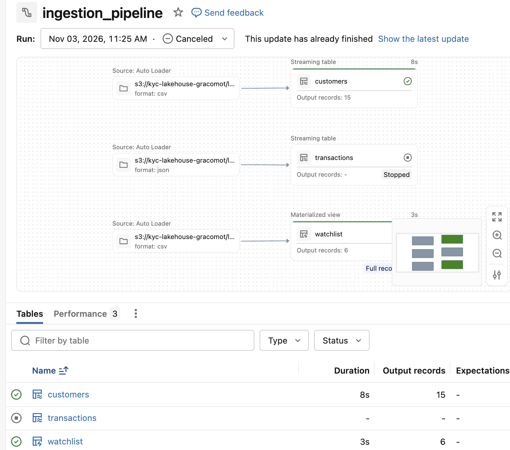

- On the successful run, transactions writes about 2,040 new rows and customers about 15. Earlier days aren’t reprocessed.

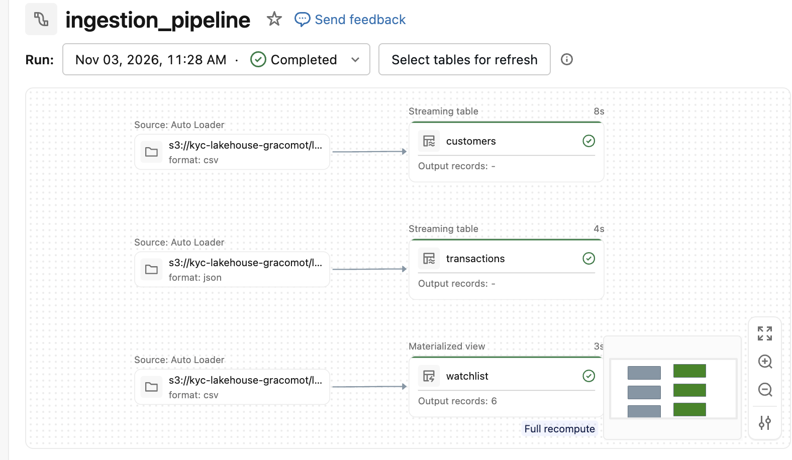

## Silver Layer

Pipeline settings: root folder `src/pipelines`, source path `src/pipelines/transformation_pipeline/transformations`, default catalog `dev_kyc`, default schema `silver`.

The silver layer of the transformation pipeline involves the following processing steps;

1. **Type Casting**:  No rows are dropped here, so every Bronze row reaches either the valid table or the quarantine table.

2. **Data Quality Check**: This is the step that loads valid records, Expectations rules  drop failing row. Thre constraints are set here and records are dropped when constraint is violated. Below are the constraints used;
```
  - txn_id IS NOT NULL
  - amount > 0
  - txn_ts IS NOT NULL
  ```
  3.  **Quarantine**: Bad records are quarantined. The constraints rules in step 2 are inverted so that bad records can be caught on a quarantine table

  4. **Deduplication**: Transaction records are deduplicated on txn_id. This is done by making it an SCD1 stream. The transaction records with a later ingest_ts is kept

  5. **Customers SCD1**: Customer is brought in as an SCD1 stream thereby overwriting duplicate customer using the customer_id filed. The customer record with the latest updated_at field is retained

  6. **Customers SCD2**: In a bid to keep history on Customers, it is brought in as an SCD2 stream on a separate filed. History is only preserved when there is a change on address, city, state, risk_rating. This is done in order to demonstrate the difference between SCD1 and SCD2. In real life, it can be brought as an SCD2 stream only

  Run the transformation_pipeline pipeline (ensure there is a transformation folder with silver.sql file). The graph from the run should look similar to the one below;

  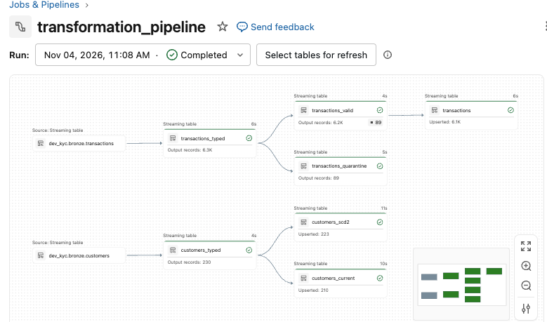


  This  has some code that can be used to validate the processing steps listed above. 

## Gold Layer

Pipeline settings: root folder `src/pipelines`, source path `src/pipelines/transformation_pipeline/transformations`, default catalog `dev_kyc`, default schema `silver`. Names in gold.sql are fully qualified because the default schema used is silver. Fully qualified names ensures that tables are created in the silver schema.

The gold layer of the transformation pipeline involves the creation of the following tables;

1. **dim_customer**:  The silver SCD2 customer table is modified so that customer full names are normalized. A surrogate key is also created using customer_id and __START_AT so as to match transaction with the correct version of customer. Remember that customer records keep history in SCD2. The __START_AT from the customer SCD2 table is modified to allow transactions that happened before the __START_AT date to be processed. 

2. **dim_date**:A date dimension table is created to include all the dates between the first transaction and the last transaction in the silver transactions table.

3. **dim_merchant**: This table is generated from the silver transactions table. It contains information related to the transaction merchant .

4. **fact_transactions**: This is the transaction fact table. it has some derived columns that do not exist in transactions that will be useful for investigative purposes

5. **watchlist_matches**: This table contains POTENTIAL matches between current customers and the watchlist on normalized name. Name-only matches are low confidence and
go to review. Customers who happen to share a name produce false positives.

6. **custoer_risk_daily**: This table contains one row per customer per day with alert flags like deposits nearing 10,000, etc.

This is the  diagram of the gold layer

  Run the transformation_pipeline pipeline (ensure there is a transformation folder with gold.sql file). The graph from the run should look similar to the one below;

  This  has some code that can be used to validate the processing steps listed above. 


## Step 5: Data Governance
In this section, we leveraged the power of unity catalog for ensuring data is secured and properly governed. We created a  file to ensure the governance take place at the user account.group level. User groups (data_engineers, analysts, compliance) need to be created in order to test how the rules work. The following controls were set up in the governance SQL file

**Mask Function on SSN**: SSN is a PII and thereby should not be visible to all and sundry. The function masks SSN to non-compliance team member i.e only members of the compliance team can see the SSN unmasked

**Row Filter Function**: This function displays rows based on the customer state. Engineers and Compliance group sees all states but analysts see in records with state in GA and FL.

**Permissions on User Groups**: Data Engineers have all privileges on the bronze, silver, gold and ops schema. Analysts and Compliance only have SELECT on the gold schema. 

This  is used to demonstrate how these governance rules work. 

## Step 6: Visualization and Dashboard Creation
In this section, we created datasets for dashboard which only consumes from the gold layer. 8 dashboards were created with each having its own datasets. Below are the dashboard that have been created;
  1. **Transaction Summary**: Overall summary of transactions, showing transaction counts, amounts and alert thresholds.

  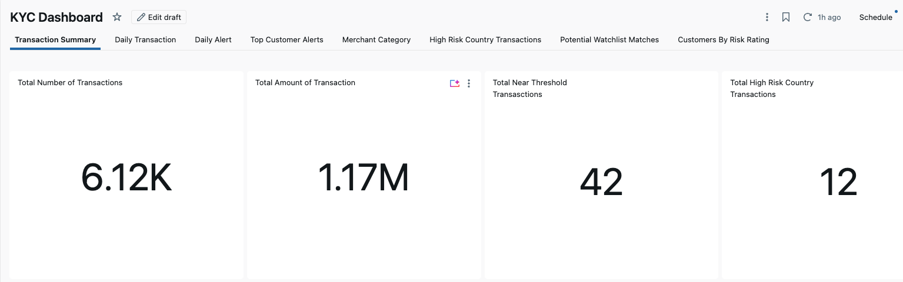

  2. **Daily Transaction**: This breaks down transaction by date showing count and total amount.

  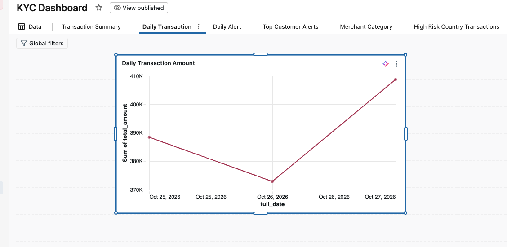

  3. **Daily Alert**: This returns daily count of alerts.

  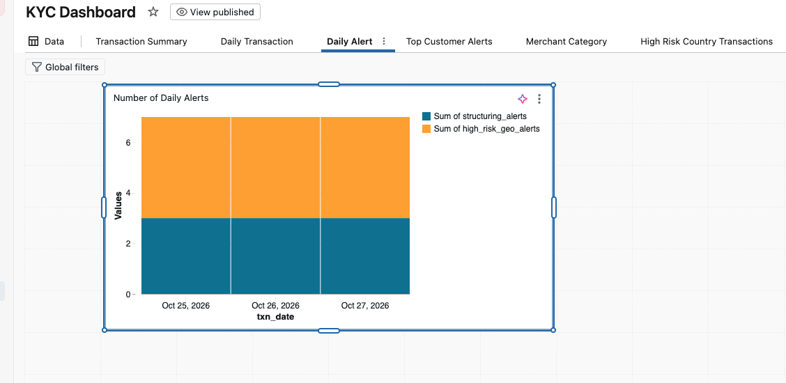

  4. **Top Customer Alerts**: Display customers with top alerts

  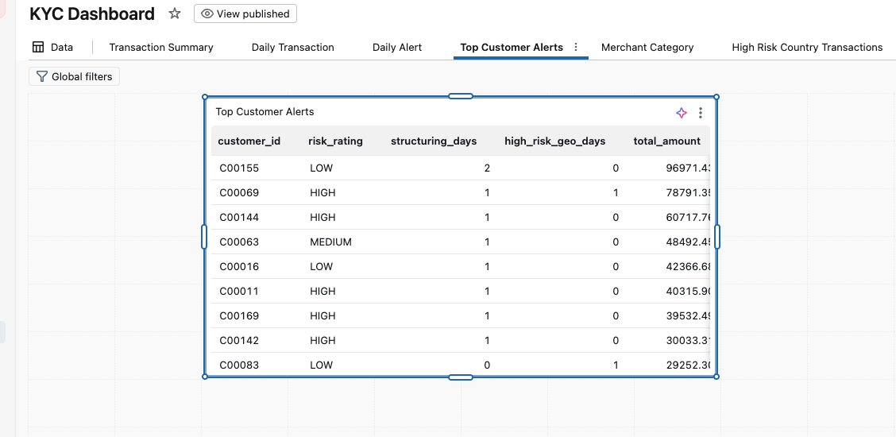

  5. **Spend By Merchant Category**: Displays amount spent by merchant category while also flagging high-risk categories

      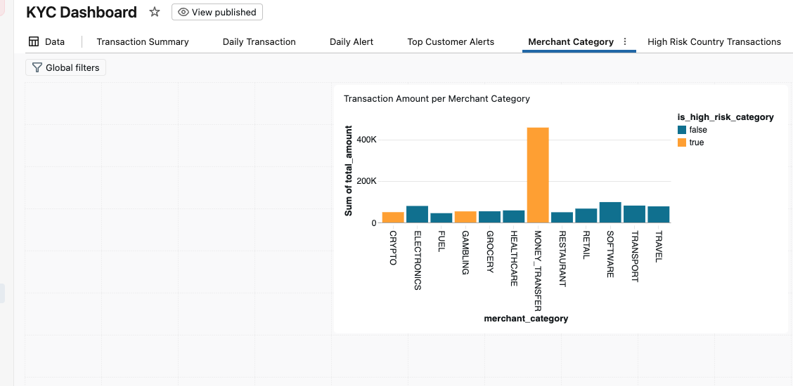

  6. **High Risk Country Activity**: Displays the count and amount of transactions in high risk countries.

        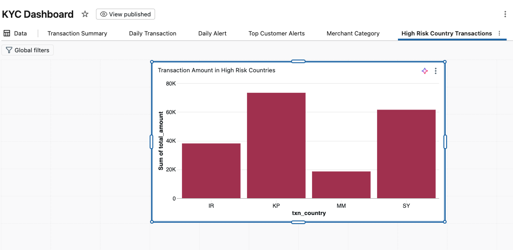


  7. **Potential Watchlist Matches**: Displays the match confidence and the count of customers that potentally matched some names in watchlist

      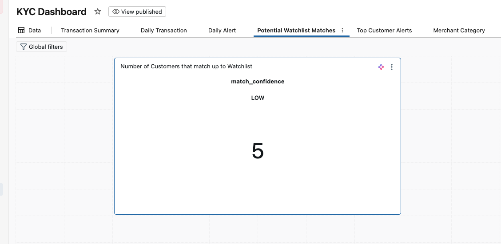

  8. **Customers By Risk Rating**: Displays the number of customers in each risk category

      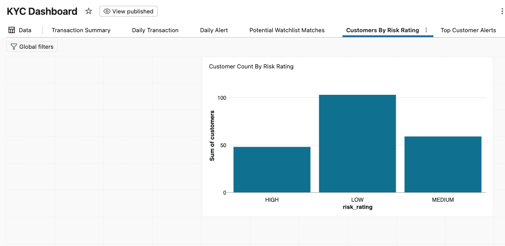

## Step 7: Orchestration

This is the step where the job pipeline is setup so we can run the bronze, silver, gold, dashboard as one job. We added 2 quality gates validate_silver and validate_gold. The DQ tasks ensures that silver and gold layers have no quality issues before the dashboard is refreshed.

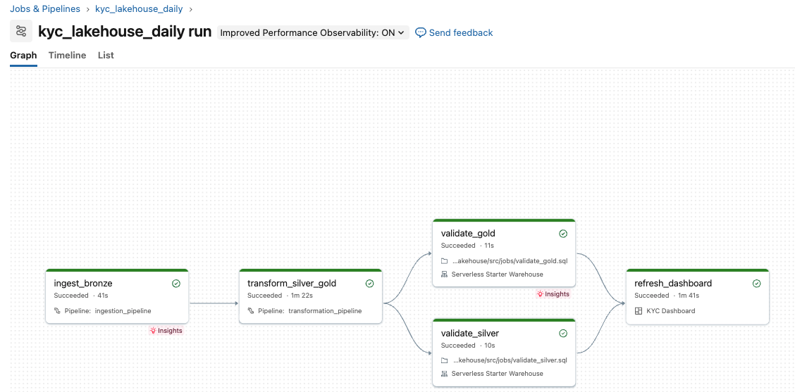

## Step 8: Monitoring and Alerts
**Root Folder**: `src/monitoring`

In this section, the pipelines is being monitored for any anomaly. On a high level, the following processes were performed;
1. Event logs were published  for the ingestion and transformation pipeline
2. Tables that are handy for monitoring our pipeline were created using SQL queries in the monitoring_setup query
3. A metric task was added to the job that depends on the validate_silver/gold tasks. This metrics are populated in the run_log ops table. It keeps track of the number of rows generated for all the medallion tables per run. This is useful are table rows may increase after each run and this tables just keeps track of the state of all the tables at each run.
4. Alerts are created based on some table columns created in step 2 e.g max_hours_since_ingest, failed_update, etc. Alerts are created using the queries in the `monitoring_queries.sql` file one alert per query


## Repository layout
```
kyc-lakehouse/
  src/
    pipelines/
      ingestion_pipeline
        transformations/
          bronze.sql              # Lakeflow Declarative Pipeline 
      transformation_pipeline
        transformations/
          silver.sql              # Lakeflow Declarative Pipeline 
          gold.sql               # Lakeflow Declarative Pipeline 
    dashboards
      dashboard_queries.sql     # SQL file that contains the queries for the dashboard datasets
      KYC Dashboard             # Contains all the dashboards

    generator/
      generate_kyc_data.py      # synthetic data generator
  docs/                         # diagrams and notes
  README.md
```

## Roadmap

- [x] S3 bucket, IAM role, storage credential, external location
- [x] Catalog and schemas
- [x] Synthetic data generator
- [x] Bronze layer (days 1-2)
- [x] Bronze incremental test (day 3 schema change, late file)
- [x] Silver: type casting, dedup, expectations, quarantine, SCD2 customers
- [x] Gold: star schema, risk aggregates, watchlist screening flags
- [x] Governance: groups, column masks, row filters, lineage
- [x] SQL warehouse and dashboard
- [x] Orchestration (Lakeflow Jobs)
- [x] Monitoring (event log, system tables, alerts)
- [ ] Asset Bundles and GitHub Actions CI/CD
- [ ] Performance tuning with before/after measurements