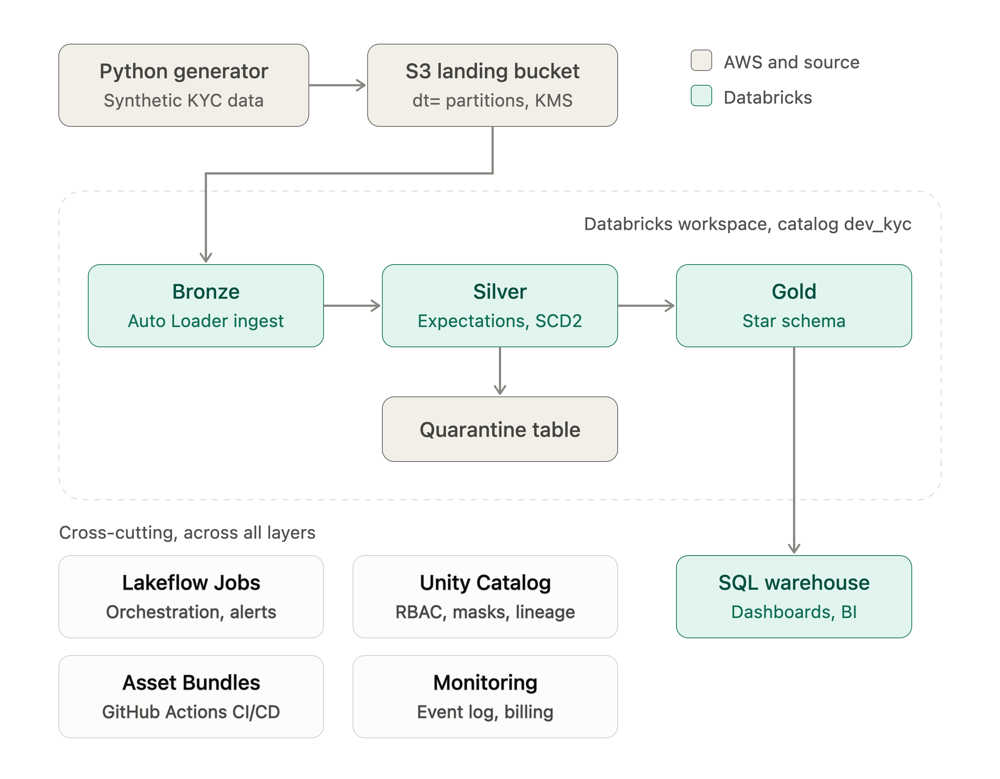
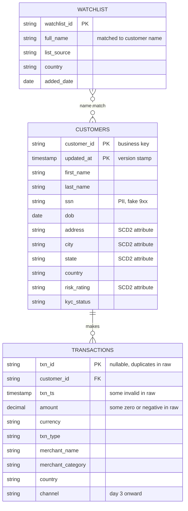
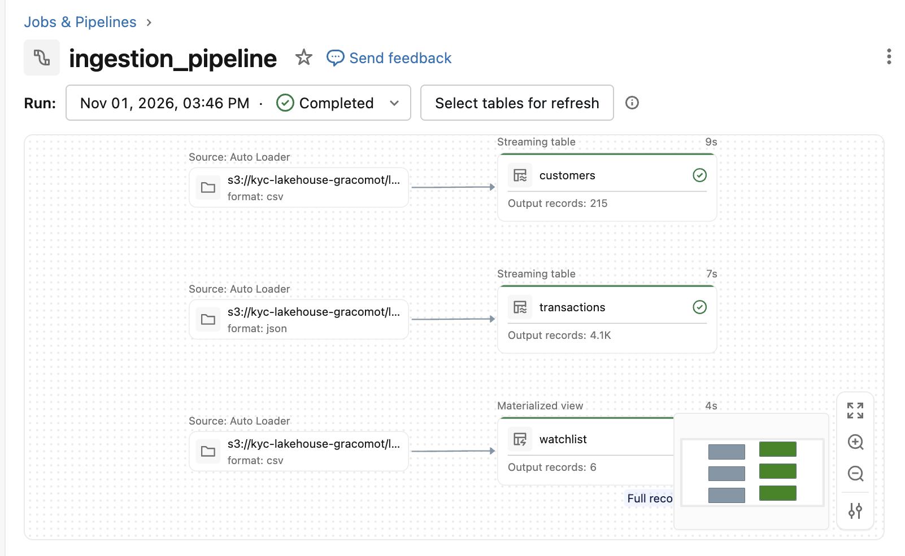
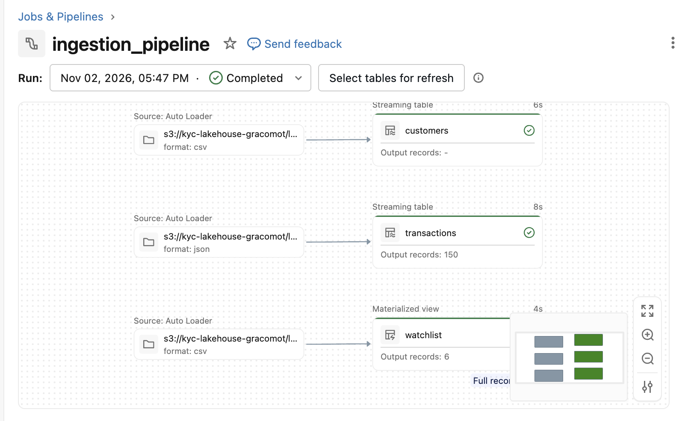

# AML/KYC Lakehouse on Databricks

An end-to-end data pipeline that ingests synthetic KYC/AML data from Amazon S3 into a Databricks lakehouse (medallion architecture), governed by Unity Catalog.

**Status:** Bronze layer complete. Silver, Gold, governance, orchestration, CI/CD and monitoring are in progress (see [Roadmap](#roadmap)).

## Scenario

A bank needs to monitor customer transactions for money-laundering risk. Three feeds arrive as files in S3:

- **Transactions:** high-volume events (JSON lines)
- **Customers:** a change feed, with attribute changes over time (CSV)
- **Watchlist:** small, slow-changing sanctions reference data (CSV)


## Architecture



## Step 1: Synthetic Data Generation
The data used in this project is fully synthetic. Names, SSNs (9xx range, never issued) and accounts are fake. This is the  used to generate the synthetic data.
 
### Data model



### Planted data issues (what each one tests)

| Issue | Purpose |
|---|---|
| Null and duplicate `txn_id` | Silver dedup and expectations |
| Zero or negative `amount` | Expectations and quarantine |
| Unparseable `txn_ts` (`not-a-date`, empty) | Type casting in Silver; Bronze must not reject bad values |
| New column called `channel` from day 3 | Auto Loader schema evolution |
| Customer address and risk rating changes | SCD Type 2 |
| Late-arriving file for day 2 (`--late`) | Auto Loader tracks files, not folders |
| Structuring (4-6 deposits of 9,000-9,900) and high-risk-country transfers | AML detection scenarios in Gold |
| Customer names matching the watchlist | Screening and false-positive handling |

## Step 2: AWS Setup
In this project we moved the generated data to S3 to mimic real life situation. We can have data coming from various sources but most times, they make their way to S3 raw and unfiltered. Using S3 provides the opportunity to learn all the necessary steps needed to connect S3 to Databricks. The S3 setup step can be skipped if AWS cost will be an issue.

### 1. S3 bucket
Create a bucket (this project uses `kyc-lakehouse-gracomot`) with default SSE-S3 encryption. Create a unique name for your S3 bucket. Upload the landing folders with the specifications (files) below;
Create a managed folder and checkpoint folders inside the bucket. `managed/` is used by Unity Catalog and stays empty of hand-written files.

```
kyc-lakehouse-<id>/
  landing/
    watchlist/
      watchlist.csv
    customers/
      dt=2026-10-25/customers.csv (day1)
      dt=2026-10-26/customers.csv (day2)
    transactions/
      dt=2026-10-25/transactions_001.json (day1)
      dt=2026-10-26/transactions_001.json (day2, leave out transactions_late_002)
  managed/        (Unity Catalog uses this, leave it empty)
  checkpoints/    (leave it empty for now)
```
As suggested above, we are loading day1 and day2 data for customers and transactions. We are leaveing out the late file in the transaction day2 folder as this will be used to explain how autoloader handles late arriving data. Watchlist is a single small file so it should be loaded.

### 2. IAM role for Unity Catalog

Role name: `kyc-lakehouse-uc-s3-access`. Setup is two passes, because the role must exist before it can trust itself and the external ID only exists after the storage credential is created.

**Step 1: create the role** 

In the AWS console, go to IAM, then Roles, then Create role. Choose Custom trust policy and paste the code below

```json
{
  "Version": "2012-10-17",
  "Statement": [{
    "Effect": "Allow",
    "Principal": { "AWS": ["arn:aws:iam::414351767826:role/unity-catalog-prod-UCMasterRole-14S5ZJVKOTYTL"] },
    "Action": "sts:AssumeRole",
    "Condition": { "StringEquals": { "sts:ExternalId": "0000" } }
  }]
}
```
That principal is a fixed Databricks-owned role, and the policy uses *0000* as a placeholder external ID. This will be changed after we create a credentials in databricks. Confirm the ARN against the current Databricks storage credential page before you save, because it’s a constant they could have changed since the writing of this documentation.

Click Next, skip attaching permissions for now, name the role, and create it.

**Step 2: create the S3 Policy** 

In the AWS console, go to IAM, then Policies, then Create policy, JSON tab. Replace the three placeholders <BUCKET>, <AWS-ACCOUNT-ID>, <ROLE-NAME>

```json
{
  "Version": "2012-10-17",
  "Statement": [
    {
      "Effect": "Allow",
      "Action": [
        "s3:GetObject",
        "s3:PutObject",
        "s3:DeleteObject",
        "s3:ListBucket",
        "s3:GetBucketLocation"
      ],
      "Resource": [
        "arn:aws:s3:::<BUCKET-NAME>/*",
        "arn:aws:s3:::<BUCKET-NAME>"
      ]
    },
    {
      "Effect": "Allow",
      "Action": ["sts:AssumeRole"],
      "Resource": ["arn:aws:iam::<AWS-ACCOUNT-ID>:role/<ROLE-NAME>"]
    }
  ]
}
```
**Step 3: Attach the S3 Policy **
Attach the S3 policY to the role. Open your role, then Permissions, then Add permissions, then Attach policies, and select the policy.

**Step 4: Copy the Role ARN **
Copy the role ARN. It’s at the top of the role page and looks like arn:aws:iam::<AWS-ACCOUNT-ID>:role/kyc-lakehouse-uc-role.

## Step 3: Hand off to Databricks
In this step, we connnect AWS S3 to databricks so we can access the data in our S3 bucket from databricks. 
Navigate to your databricks account;
1. **Catalog > External data > Credentials > Create credential**, select *Storage credential*, type AWS IAM Role. Enter a name and the role ARN. Databricks then shows the external ID. Copy the external ID.

2. **Finish the trust policy**
Back in AWS, open the role, go to the Trust relationships tab, and replace the <EXTERNAL_ID> that was prviously 0000 with the one provided by databricks.

3. Create an **external location** (manual setup) named `kyc_lakehouse_loc` on `s3://<bucket-nam>` using that credential.

4. Click **Test connection**. A pass confirms the role, trust policy and permissions are aligned.

## Step 4: Create Catalog and schemas

```sql
CREATE CATALOG IF NOT EXISTS dev_kyc
  MANAGED LOCATION 's3://kyc-lakehouse-gracomot/managed';

CREATE SCHEMA IF NOT EXISTS dev_kyc.bronze;
CREATE SCHEMA IF NOT EXISTS dev_kyc.silver;
CREATE SCHEMA IF NOT EXISTS dev_kyc.gold;
CREATE SCHEMA IF NOT EXISTS dev_kyc.ops;
```

Unity Catalog also creates `default` and `information_schema` automatically. Confirm schemas have been created by running the
statement.
 `SHOW SCHEMAS IN dev_kyc;`


## Bronze layer

Pipeline settings: root folder `src/pipelines`, source path `src/pipelines/transformations`, default catalog `dev_kyc`, default schema `bronze`.

```sql
CREATE OR REFRESH STREAMING TABLE transactions AS
SELECT *, _metadata.file_path AS source_file, current_timestamp() AS ingest_ts
FROM STREAM read_files('s3://kyc-lakehouse-gracomot/landing/transactions/', format => 'json');

CREATE OR REFRESH STREAMING TABLE customers AS
SELECT *, _metadata.file_path AS source_file, current_timestamp() AS ingest_ts
FROM STREAM read_files('s3://kyc-lakehouse-gracomot/landing/customers/', format => 'csv', header => true);

CREATE OR REFRESH MATERIALIZED VIEW watchlist AS
SELECT *, _metadata.file_path AS source_file, current_timestamp() AS ingest_ts
FROM read_files('s3://kyc-lakehouse-gracomot/landing/watchlist/', format => 'csv', header => true);
```

**Note**: Two metadata columns (source_file and ingest_ts)have been appended to the tables for auditability. They record where each row came from and when it was loaded, which are two things the raw data can’t tell you itself. Bronze is the system of record for what arrived, so it needs that provenance.

**Bronze rules**: no cleaning, append-only, audit columns only (`source_file`, `ingest_ts`). Dirty data stays so the layer is auditable and replayable.

### Verified results (days 1-2 loaded)

| Table | Rows |
|---|---|
| `dev_kyc.bronze.customers` | 215 |
| `dev_kyc.bronze.transactions` | 4,076 |
| `dev_kyc.bronze.watchlist` | 6 |

## Design Decisions

| Decision | Why |
|---|---|
| Medallion layers | Replayability, separation of raw from curated, incremental quality gates |
| Auto Loader (via `read_files` in a streaming table) | Incremental, checkpointed, handles schema evolution; no custom file tracking |
| Streaming tables for Bronze, materialized view for the watchlist | Streaming tables assume append-only sources. The watchlist is small reference data that can be replaced, so a materialized view (no `STREAM`) fits |
| Managed tables for all medallion layers | Unity Catalog owns lifecycle and access; supports predictive optimization. Any layer can be rebuilt from the raw files in `landing/`, which dropping a table never touches |
| Landing files stay outside managed storage | Raw files remain the source of truth |
| No schema-level `MANAGED LOCATION` | Not needed for one dataset; a path nested under the catalog's managed location may also trigger an overlap error |
| Default SSE-S3 encryption for now | Avoids a second permission layer (KMS) while building. Moving to SSE-KMS with a customer-managed key is a planned hardening step |
| Name-only watchlist matching | The watchlist has no reliable shared identifier (SSNs are US-only and rare on real lists). Treat matches as potential, score with secondary attributes, and route to review |

## Issues hit and fixes

| Issue | Cause and fix |
|---|---|
| Role setup seemed circular | The role must exist before it can trust itself, and the external ID only exists after the credential is created. Create with a placeholder, then update the trust policy |
| Test connection fails | Usually the external ID in the trust policy doesn't match exactly, or the role's own ARN is missing from the trust policy (self-assume) |
| SQL pasted into `my_transformation.py` | The file extension sets the language. Create a `.sql` file and delete the template |
| `_metadata.file_path` missing from a table | `_metadata` is a hidden column and must be selected explicitly |
| `STREAM` missing on the watchlist | Intentional: a materialized view is a batch query, so it has no `STREAM` |
| `SHOW GRANTS` returned no rows | Owners have all privileges implicitly. Grants only list explicit grants |

## Repository layout

```
kyc-lakehouse/
  src/
    pipelines/
      ingestion
        transformations/
          bronze.sql              # Lakeflow Declarative Pipeline source
    generator/
      generate_kyc_data.py      # synthetic data generator
  docs/                         # diagrams and notes
  README.md
```

### Late Arriving Data
In this session, we will explain how autoloader handles late arriving data. The  has some handy code you can run to demonstrate how autoloader handles late arriving files. We will go through the following steps

1. **Record a baseline**
```
SELECT COUNT(*) FROM dev_kyc.bronze.transactions;   -- 4,076
SELECT source_file, COUNT(*) FROM dev_kyc.bronze.transactions GROUP BY 1;
```
In the jobs and Pipelines section, the graph for the last pipeline will look like the one below, notice the count;



2. **Upload the late file**
Upload the late file transactions_late_002 in day 2 of S3 transaction folder and rerun the pipeline.


3. Rerun the Ingestion Pipeline
Use the normal Run pipeline button, not Full refresh. A full refresh reloads everything and would hide the incremental behavior you’re trying to show.

The transaction node writes about 150 rows. This shows that only new file was processed. Watchlist was processed again since it is a materialized table.




## Roadmap

- [x] S3 bucket, IAM role, storage credential, external location
- [x] Catalog and schemas
- [x] Synthetic data generator
- [x] Bronze layer (days 1-2)
- [ ] Bronze incremental test (day 3 schema change, late file)
- [ ] Silver: type casting, dedup, expectations, quarantine, SCD2 customers
- [ ] Gold: star schema, risk aggregates, watchlist screening flags
- [ ] Governance: groups, column masks, row filters, lineage
- [ ] SQL warehouse and dashboard
- [ ] Orchestration (Lakeflow Jobs)
- [ ] Asset Bundles and GitHub Actions CI/CD
- [ ] Monitoring (event log, system tables, alerts)
- [ ] Performance tuning with before/after measurements
